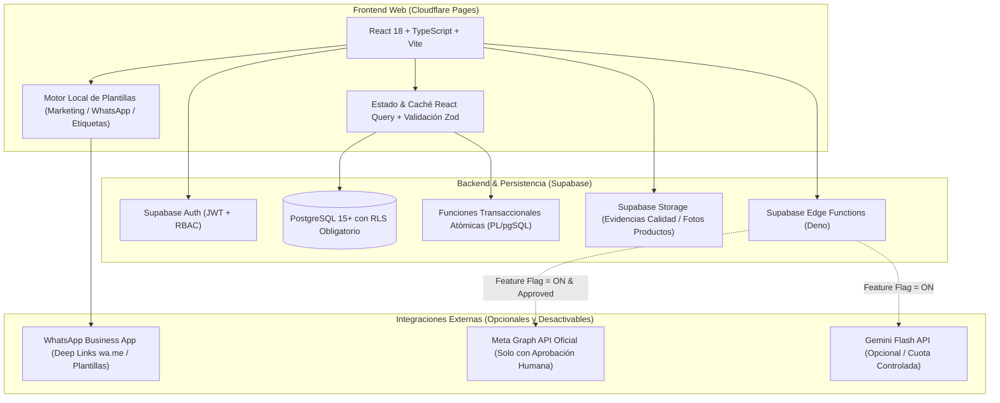

# ARQUITECTURA DE SOFTWARE — REAL TWS COMMERCE SYSTEM

## 1. Visión Arquitectónica

**REAL TWS COMMERCE SYSTEM** adopta una arquitectura modular orientada al dominio (**Modular Domain-Driven Architecture**) sobre un stack **Serverless / BaaS (Supabase)** y un frontend **React + TypeScript + Vite** desplegado en **Cloudflare Pages**.

El principio rector del sistema es la **Trazabilidad Multipropietario por Lote**:
- Los productos (`products`) y sus variantes comerciales (`product_variants` / SKU) son **entidades universales del catálogo** y no pertenecen de forma fija a una persona.
- La propiedad real reside en la intersección **Lote + SKU + Propietario** (`stock_lot_ownership`).
- Cada movimiento físico, inspección de calidad, venta, gasto, transferencia y liquidación conserva referencia explícita al propietario (`owner_id`) y al lote (`lot_id`), garantizando contabilidad separada sin duplicar el catálogo ni mezclar costos.

---

## 2. Diagrama General de Arquitectura



---

## 3. Estructura de Directorios y Módulos del Sistema

El proyecto cuenta con una estructura limpia y separada por responsabilidades, lista para conectarse a Supabase en la Fase 2:

```text
REAL TWS/
├── docs/                       # Documentación maestra del proyecto (Reglas, Arquitectura, BD, Roadmap, ADR, Changelog)
├── supabase/
│   └── migrations/             # Migraciones SQL numeradas para PostgreSQL 15+, RLS y funciones RPC (Fase 2)
├── INVENTARIO_REAL_TWS/        # Fuente oficial de datos reales auditados (OWN-0001 Eberto) y backup inmutable
└── src/
    ├── app/                    # Shell principal (AppLayout.tsx) y enrutador de 25 rutas (AppRouter.tsx)
    ├── components/             # Componentes UI reutilizables (Sidebar, Header, DataTable, FilterBar, ConfirmModal, NotificationCenter, StatusStates, LucideIcon)
    ├── hooks/                  # Hooks de contexto y estado (useOwnerScope.tsx, useNotifications.tsx)
    ├── lib/                    # Cliente tipado de Supabase (supabase.ts) y mapa de navegación de 5 grupos / 25 módulos (navigation.ts)
    ├── modules/                # Módulos de dominio (dashboard/DashboardModule.tsx y shared/ModuleBlueprintView.tsx)
    ├── services/               # Servicios de negocio y línea base auditada (systemService.ts)
    ├── styles/                 # Sistema de diseño CSS corporativo Negro Carbón y Dorado (theme.css)
    ├── types/                  # Contratos TypeScript estrictos (domain.ts)
    └── utils/                  # Formateadores COP/fechas (formatters.ts) y validaciones de reglas (validations.ts)
```

### Mapa Oficial de Navegación (5 Grupos / 25 Módulos)
1. **OPERACIONES:** `Dashboard` (`/`), `Productos` (`/operaciones/productos`), `Inventario` (`/operaciones/inventario`), `Recepciones y Compras` (`/operaciones/recepciones-compras`).
2. **FINANZAS:** `Costos` (`/finanzas/costos`), `Precios` (`/finanzas/precios`), `Gastos` (`/finanzas/gastos`), `Propietarios` (`/finanzas/propietarios`), `Liquidaciones` (`/finanzas/liquidaciones`).
3. **COMERCIAL:** `Pedidos` (`/comercial/pedidos`), `Clientes` (`/comercial/clientes`), `CRM` (`/comercial/crm`), `Despachos` (`/comercial/despachos`).
4. **MARKETING:** `Branding` (`/marketing/branding`), `Merchandising` (`/marketing/merchandising`), `Creative Studio` (`/marketing/creative-studio`), `Marketplace` (`/marketing/marketplace`), `Social Publisher` (`/marketing/social-publisher`), `WhatsApp` (`/marketing/whatsapp`), `Meta Ads` (`/marketing/meta-ads`).
5. **GESTIÓN:** `Automatizaciones` (`/gestion/automatizaciones`), `Analítica` (`/gestion/analitica`), `Configuración` (`/gestion/configuracion`), `Usuarios` (`/gestion/usuarios`), `Auditoría` (`/gestion/auditoria`).

---

## 4. Diseño de Flujos Críticos y Transaccionalidad

### 4.1. Flujo de Recepción, Asignación y Calidad (Reglas 8, 11, 12, 13)
1. **Recepción de Mercancía (`stock_lots`):** Se registra una compra o ingreso físico indicando proveedor, documento y costos de compra/transporte (o `NULL` si el costo está pendiente de información).
2. **Asignación de Propiedad (`stock_lot_ownership`):** Se asignan las unidades recibidas de cada SKU a un propietario explícito (`owner_id` obligatorio; prohibido preseleccionar `OWN-0001` en nuevos registros).
3. **Estado Inicial de Stock:** Toda mercancía nueva o importada del Excel sin inspección aprobada ingresa con `qty_pending = qty_physical` y `qty_good = 0`, por lo que `qty_available = 0`.
4. **Inspección de Calidad (`quality_inspections`):** Cuando el operador registra y aprueba la prueba funcional/visual, una función RPC transaccional descuenta de `qty_pending` y suma a `qty_good` (o `qty_defective`), habilitando `qty_available = qty_good - qty_reserved` para la venta.

### 4.2. Flujo de Venta Multipropietario Atómica (Reglas 9, 10, 14)
1. Un pedido (`sales_orders`) puede incluir productos pertenecientes a uno o varios propietarios.
2. Al confirmar la venta mediante la función RPC `fn_confirm_sale_order`:
   - Se bloquean (`FOR UPDATE`) los registros de `stock_lot_ownership` seleccionados.
   - Se verifica que `qty_available >= qty_sold` para cada lote y propietario.
   - Se crean los registros en `sales_item_allocations`, vinculando cada unidad vendida a su `owner_id`, `lot_id` y `unit_cost_cop` exacto de ese lote.
   - Se descuenta el stock disponible del lote/propietario correspondiente y se inserta el movimiento en `stock_movements`.
   - Nunca se duplica el ingreso del pedido y nunca se usa el catálogo maestro para adivinar el propietario.

### 4.3. Flujo de Gastos, Utilidades y Liquidaciones (Reglas Financieras)
1. **Gastos Directos y Compartidos (`expenses` + `owner_expense_allocations`):**
   - Los gastos directos se asignan directamente al propietario afectado.
   - Los gastos compartidos exigen seleccionar el método de distribución (`manual`, `sales_ratio`, `cogs_ratio`, `units_ratio`) y guardan instantánea del cálculo para no alterar períodos cerrados.
2. **Estado de Resultados (`v_owner_pnl`):** Calcula en tiempo real por propietario y rango de fechas: Ventas Brutas, Descuentos, Devoluciones, Ventas Netas, CMV, Utilidad Bruta, Gastos Directos, Gastos Compartidos, Utilidad Atribuible, Dinero Cobrado, Liquidaciones Pagadas y Saldo Pendiente.
3. **Liquidación (`fn_create_owner_settlement`):**
   - Verifica que el propietario tenga un acuerdo válido configurado en `owner_agreements` (si no existe, muestra `PENDIENTE DE CONFIGURAR ACUERDO DE DISTRIBUCIÓN` y bloquea el pago).
   - Verifica que la utilidad atribuible y el saldo pendiente sean positivos ($> 0$) y que el monto a liquidar no supere el saldo disponible.

### 4.4. Flujo de Marketing, WhatsApp y Meta Graph API (Reglas 13, 16, 17, 18, 20)
1. **Verificación de Disponibilidad:** El generador de publicaciones solo permite seleccionar SKUs con `qty_available > 0`.
2. **Generación de Contenido Local vs. IA:**
   - **Modo Predeterminado (Costo \$0):** Motor local de plantillas en TypeScript que combina especificaciones técnicas verificadas, modelo, variante y precio aprobado.
   - **Modo Asistido Opcional:** Si `gemini_enabled = true` en `app_settings` y el usuario lo solicita manualmente, invoca una Supabase Edge Function hacia `gemini-flash` respetando el límite diario configurado.
3. **Aprobación Humana Obligatoria:** Toda pieza se guarda como `draft` $\rightarrow$ `pending_approval`. Solo un usuario `admin` puede cambiarla a `approved`.
4. **Canales de Salida Oficiales:**
   - **WhatsApp Business App:** Generación de texto formateado y enlaces profundos (`https://wa.me/...`) listos para enviar con un clic, sin bots no oficiales.
   - **Meta Graph API:** Publicación orgánica hacia página oficial únicamente a través de Edge Function tras aprobación explícita. Prohibida la creación automática de pauta pagada.
