# DISEÑO MAESTRO DE BASE DE DATOS — REAL TWS COMMERCE SYSTEM

Especificación integral de base de datos relacional sobre **PostgreSQL 15+ y Supabase** para **REAL TWS COMMERCE SYSTEM**.

> **Estado:** Diseño completo y migraciones numeradas generadas en `supabase/migrations/`. **No se han ejecutado cambios sobre ninguna instancia activa**, respetando la instrucción de validación previa.

---

## 1. Diagrama Entidad-Relación (ER)

```mermaid
erDiagram
    OWNERS ||--o{ PROFILES : "vincula acceso opcional"
    OWNERS ||--o{ OWNER_AGREEMENTS : "define acuerdo"
    OWNERS ||--o{ PURCHASE_RECEIPT_LINES : "recibe compra"
    OWNERS ||--o{ LOT_OWNER_ALLOCATIONS : "posee lote/SKU"
    OWNERS ||--o{ STOCK_MOVEMENTS : "registra kardex"
    OWNERS ||--o{ QUALITY_INSPECTIONS : "inspecciona lote"
    OWNERS ||--o{ STOCK_RESERVATIONS : "reserva stock"
    OWNERS ||--o{ COST_RECORDS : "registra costo"
    OWNERS ||--o{ EXPENSE_ALLOCATIONS : "asume gasto"
    OWNERS ||--o{ SALES_ITEM_ALLOCATIONS : "recibe atribución venta"
    OWNERS ||--o{ RETURNS : "afecta devolución"
    OWNERS ||--o{ OWNERSHIP_TRANSFERS : "transfiere propiedad"
    OWNERS ||--o{ OWNER_SETTLEMENTS : "recibe liquidación"

    PRODUCTS ||--|{ PRODUCT_VARIANTS : "agrupa variantes SKU"
    PRODUCT_VARIANTS ||--o{ PRICE_HISTORY : "audita precios"
    PRODUCT_VARIANTS ||--o{ PURCHASE_RECEIPT_LINES : "se compra en"
    PRODUCT_VARIANTS ||--o{ STOCK_LOTS : "origina lote"
    PRODUCT_VARIANTS ||--o{ LOT_OWNER_ALLOCATIONS : "se almacena por dueño"
    PRODUCT_VARIANTS ||--o{ SALES_ORDER_ITEMS : "se vende en línea"
    PRODUCT_VARIANTS ||--o{ MARKETING_ASSETS : "tiene piezas"
    PRODUCT_VARIANTS ||--o{ PUBLICATIONS : "se promociona si disponible"

    SUPPLIERS ||--o{ PURCHASE_RECEIPTS : "emite factura/entrega"
    PURCHASE_RECEIPTS ||--|{ PURCHASE_RECEIPT_LINES : "contiene líneas"
    PURCHASE_RECEIPT_LINES ||--o{ STOCK_LOTS : "genera lote"
    STOCK_LOTS ||--|{ LOT_OWNER_ALLOCATIONS : "asigna existencias"

    LOT_OWNER_ALLOCATIONS ||--o{ STOCK_MOVEMENTS : "genera movimiento inmutable"
    LOT_OWNER_ALLOCATIONS ||--o{ QUALITY_INSPECTIONS : "se evalúa en"
    LOT_OWNER_ALLOCATIONS ||--o{ STOCK_RESERVATIONS : "bloquea temporalmente"
    LOT_OWNER_ALLOCATIONS ||--o{ COST_RECORDS : "detalla capas de costo"
    LOT_OWNER_ALLOCATIONS ||--o{ SALES_ITEM_ALLOCATIONS : "descuenta unidad vendida"

    CUSTOMERS ||--o{ LEADS : "convierte prospecto"
    CUSTOMERS ||--o{ SALES_ORDERS : "realiza pedido"
    SALES_ORDERS ||--|{ SALES_ORDER_ITEMS : "contiene ítems"
    SALES_ORDER_ITEMS ||--|{ SALES_ITEM_ALLOCATIONS : "descompone por dueño/lote"
    SALES_ORDERS ||--o{ PAYMENTS : "recibe pagos"
    SALES_ORDERS ||--o{ SHIPMENTS : "despacha guía"
    SALES_ITEM_ALLOCATIONS ||--o{ RETURNS : "origina devolución"

    EXPENSES ||--|{ EXPENSE_ALLOCATIONS : "prorratea gasto"
    MARKETING_ASSETS ||--o{ CONTENT_CALENDAR : "programa pieza"
    CONTENT_CALENDAR ||--o{ PUBLICATIONS : "ejecuta publicación"
    ADS_CAMPAIGNS ||--o{ ADS_CAMPAIGN_METRICS : "registra métricas diarias"
    AUTOMATION_JOBS ||--o{ AUTOMATION_LOGS : "registra ejecuciones"
```

---

## 2. Diccionario de Datos Completo (32 Dominios / 33 Tablas)

### Bloque I — Identidad, Roles, Propietarios y Catálogo (`0002_identity_owners_and_catalog.sql`)

| Nº | Entidad / Tabla | Clave Primaria | Columnas Principales | Reglas e Integridad (`CHECK` / `UNIQUE`) |
| :--- | :--- | :--- | :--- | :--- |
| **1** | `public.profiles` | `id UUID` (`FK auth.users`) | `full_name`, `email`, `role` (`app_role`: `'administrador'`, `'operador'`, `'vendedor'`, `'propietario'`), `linked_owner_id`, `owner_portal_enabled`, `is_active` | `chk_profiles_owner_link`: si `role = 'propietario'`, `linked_owner_id IS NOT NULL`. |
| **2** | `public.owners` | `id TEXT` (`OWN-0001`) | `internal_code`, `full_name`, `document_type`, `document_number`, `phone`, `email`, `status`, `portal_access_enabled`, `notes` | Formato obligatorio `^OWN-[0-9]{4,}$`. Registro inicial único: `OWN-0001` (`Eberto`). |
| **3** | `public.owner_agreements` | `id TEXT` (`AGR-0001`) | `agreement_code`, `owner_id`, `distribution_model`, `owner_share_pct`, `store_commission_pct`, `status`, `effective_from`, `approved_by`, `private_agreement_storage_path` | Índice parcial único `WHERE status = 'active'`. Prohibido asumir porcentajes: inicia en `'pending_configuration'`. |
| **4A** | `public.products` | `id UUID` | `legacy_excel_row_id`, `product_code` (`UNIQUE`), `category`, `subcategory`, `name`, `brand`, `model`, `manufacturer_ref`, `supplier_ref`, `verified_specs` (`JSONB`), `original_excel_notes` | **Sin propietario obligatorio**: el catálogo maestro es universal. |
| **4B** | `public.product_variants` | `id UUID` | `sku` (`UNIQUE`), `product_id`, `variant_name`, `color`, `presentation`, `barcode`, `current_approved_price_cop`, `is_published_in_catalog`, `status` | El `sku` identifica la variante y puede asociarse a múltiples propietarios vía lotes. |
| **5** | `public.suppliers` | `id UUID` | `supplier_code` (`UNIQUE`), `legal_name`, `contact_name`, `tax_id`, `phone`, `email`, `city`, `address`, `status` | Proveedores físicos o mayoristas vinculados a recepciones y gastos. |
| **13** | `public.price_history` | `id UUID` | `variant_id`, `sku`, `previous_price_cop`, `new_price_cop`, `change_reason`, `effective_from`, `effective_to`, `approved_by` | **Inmutable** (`trg_price_history_immutable`): audita cada cambio manual de precio comercial. |

---

### Bloque II — Compras, Lotes, Asignación Multipropietario, Kardex y Calidad (`0003_purchases_inventory_and_quality.sql`)

| Nº | Entidad / Tabla | Clave Primaria | Columnas Principales | Reglas e Integridad (`CHECK` / `UNIQUE`) |
| :--- | :--- | :--- | :--- | :--- |
| **6A** | `public.purchase_receipts` | `id UUID` | `receipt_number` (`UNIQUE`), `supplier_id`, `invoice_reference`, `receipt_date`, `receipt_status`, `subtotal_purchase_cop`, `inbound_shipping_cop`, `other_import_costs_cop`, `private_invoice_storage_path` | Totales no negativos (`>= 0`). Facturas protegidas en bucket privado. |
| **6B** | `public.purchase_receipt_lines` | `id UUID` | `purchase_receipt_id`, `line_number`, `variant_id`, `sku`, `owner_id` (**sin default**), `qty_invoiced`, `qty_received`, `unit_purchase_cost_cop`, `allocated_unit_shipping_cop`, `is_bonus_item`, `cost_status` | `owner_id` obligatorio sin preasignar `OWN-0001`. Soporta `pending_info` (`NULL`) y `bonus_zero_cost` (`$0`). |
| **7** | `public.stock_lots` | `id TEXT` (`LOT-INI-2026-01`) | `purchase_receipt_id`, `purchase_receipt_line_id`, `variant_id`, `sku`, `lot_origin`, `received_date`, `warehouse_location`, `lot_status` | Trazabilidad del origen del lote (`excel_initial_import`, `purchase_receipt`, `ownership_transfer`, `customer_return`). |
| **8** | `public.lot_owner_allocations` | `id UUID` | `allocation_code` (`ASG-0001`), `lot_id`, `variant_id`, `sku`, `owner_id` (**sin default**), `storage_bin`, `qty_physical`, `qty_good`, `qty_defective`, `qty_pending_inspection`, `qty_reserved`, `qty_available` (`GENERATED`), `purchase_unit_cost_cop`, `inbound_shipping_unit_cost_cop`, `effective_unit_cost_cop` (`GENERATED`), `is_bonus_zero_cost`, `reconciliation_state` | `CHECK (qty_physical IS NULL OR qty_physical = qty_good + qty_defective + qty_pending_inspection)` y `CHECK (qty_reserved <= qty_good)`. `UNIQUE (lot_id, sku, owner_id, storage_bin)`. |
| **9** | `public.stock_movements` | `id UUID` | `movement_seq` (`BIGSERIAL`), `lot_allocation_id`, `lot_id`, `variant_id`, `sku`, `owner_id`, `movement_type`, `delta_physical`, `delta_good`, `delta_defective`, `delta_pending`, `delta_reserved`, `balance_*_after`, `unit_cost_snapshot_cop`, `reference_entity`, `reference_id`, `reason`, `performed_by` | **Libro Kardex Inmutable** (`trg_stock_movements_immutable`): bloquea `UPDATE` y `DELETE`. Conserva instantánea de saldos posteriores a cada operación. |
| **10** | `public.quality_inspections` | `id UUID` | `inspection_code`, `lot_allocation_id`, `lot_id`, `sku`, `owner_id`, `qty_inspected`, `qty_approved_good`, `qty_marked_defective`, `qty_remaining_pending`, `visual_check_passed`, `functional_test_passed`, `accessories_complete`, `inspection_status`, `inspector_name` | `CHECK (qty_inspected = qty_approved_good + qty_marked_defective + qty_remaining_pending)`. |
| **11** | `public.stock_reservations` | `id UUID` | `reservation_code`, `lot_allocation_id`, `owner_id`, `sku`, `sales_order_ref`, `qty_reserved`, `qty_fulfilled`, `qty_released`, `reservation_status`, `expires_at`, `reason` | `CHECK ((qty_fulfilled + qty_released) <= qty_reserved)`. |
| **12** | `public.cost_records` | `id UUID` | `lot_allocation_id`, `lot_id`, `owner_id`, `sku`, `cost_type`, `unit_amount_cop`, `total_amount_cop`, `qty_basis`, `source_document_ref`, `recorded_by` | Historial auditado de capas de costo por lote y propietario. |
| **24** | `public.ownership_transfers` | `id TEXT` (`TRF-0001`) | `transfer_date`, `lot_id`, `sku`, `source_lot_allocation_id`, `target_lot_allocation_id`, `from_owner_id`, `to_owner_id`, `qty_transferred`, `unit_cost_transferred_cop`, `reason`, `authorized_by` | `CHECK (from_owner_id <> to_owner_id)`. Transfiere propiedad hacia adelante sin alterar ventas históricas. |
| **Aux** | `public.inventory_incidences` | `id TEXT` (`INC-001`) | `severity`, `affected_module`, `sku_or_owner_ref`, `owner_id`, `description`, `required_action`, `status`, `resolved_at` | Conserva las 7 incidencias reales detectadas al auditar el Excel de Eberto. |

---

### Bloque III — Comercial, Clientes, Leads, Ventas Multipropietario, Pagos, Devoluciones y Despachos (`0004_commercial_sales_and_logistics.sql`)

| Nº | Entidad / Tabla | Clave Primaria | Columnas Principales | Reglas e Integridad (`CHECK` / `UNIQUE`) |
| :--- | :--- | :--- | :--- | :--- |
| **16** | `public.customers` | `id UUID` | `customer_code` (`UNIQUE`), `full_name`, `document_type`, `document_number`, `phone_whatsapp`, `email`, `city`, `department`, `shipping_address`, `status` | Directorio maestro de compradores. |
| **17** | `public.leads` | `id UUID` | `lead_code` (`UNIQUE`), `customer_id`, `full_name`, `phone_whatsapp`, `source_channel`, `interested_sku`, `lead_stage`, `assigned_to`, `next_followup_at` | Embudo CRM (`new`, `contacted`, `quoted`, `negotiation`, `won`, `lost`). |
| **18** | `public.sales_orders` | `id UUID` | `order_number` (`UNIQUE`), `order_date`, `customer_id`, `lead_id`, `sales_channel`, `allocation_policy_used`, `order_status`, `payment_status`, `subtotal_gross_cop`, `discount_total_cop`, `shipping_charged_cop`, `returned_total_cop`, `net_order_total_cop` (`GENERATED`), `total_collected_cop` | `allocation_policy_used` exige `'explicit_manual_selection'` o `'approved_fifo_policy'`. Separa ingreso devengado de dinero efectivamente cobrado (`total_collected_cop`). |
| **19** | `public.sales_order_items` | `id UUID` | `sales_order_id`, `line_number`, `variant_id`, `sku`, `qty_ordered`, `qty_returned`, `unit_sale_price_cop`, `line_discount_cop`, `line_gross_total_cop` (`GENERATED`), `line_net_total_cop` (`GENERATED`) | `UNIQUE (sales_order_id, line_number)` y `qty_returned <= qty_ordered`. |
| **20** | `public.sales_item_allocations` | `id UUID` | `allocation_sale_code` (`VTA-0001`), `sales_order_id`, `sales_order_item_id`, `lot_allocation_id`, `lot_id`, `owner_id`, `agreement_id`, `variant_id`, `sku`, `qty_allocated`, `qty_returned`, `unit_sale_price_cop`, `discount_allocated_cop`, `return_amount_cop`, `gross_revenue_cop` (`GENERATED`), `net_revenue_cop` (`GENERATED`), `unit_cost_cop`, `cogs_total_cop` (`GENERATED`), `direct_selling_expense_cop`, `gross_profit_cop` (`GENERATED`), `store_commission_cop`, `attributable_owner_profit_cop`, `commission_calculation_status` | **Descomposición obligatoria Propietario–Lote–Cantidad–Costo**. Previene doble contabilización mediante validación transaccional `SUM(qty_allocated) <= qty_ordered`. |
| **21** | `public.payments` | `id UUID` | `payment_code` (`UNIQUE`), `sales_order_id`, `payment_date`, `payment_method`, `amount_cop`, `payment_status`, `external_reference`, `private_voucher_storage_path` | Registra abonos y recaudos reales por medio de pago (`cash`, `nequi`, `daviplata`, `bank_transfer`, `card`, `cod_carrier`). |
| **22** | `public.returns` | `id UUID` | `return_code` (`UNIQUE`), `sales_order_id`, `sales_order_item_id`, `sales_item_allocation_id`, `lot_allocation_id`, `owner_id`, `sku`, `qty_returned`, `item_condition`, `refund_amount_cop`, `reason`, `return_status` | Afecta exactamente al lote y propietario de la asignación original (`good_restock`, `defective_warranty`, `pending_inspection`). |
| **23** | `public.shipments` | `id UUID` | `shipment_code` (`UNIQUE`), `sales_order_id`, `carrier_name`, `tracking_number`, `recipient_name`, `recipient_phone`, `destination_city`, `destination_address`, `shipping_cost_cop`, `shipment_status`, `dispatched_at`, `delivered_at` | Trazabilidad logística de guías y entregas. |

---

### Bloque IV — Finanzas: Gastos, Asignaciones de Gastos y Liquidaciones (`0005_finance_expenses_and_settlements.sql`)

| Nº | Entidad / Tabla | Clave Primaria | Columnas Principales | Reglas e Integridad (`CHECK` / `UNIQUE`) |
| :--- | :--- | :--- | :--- | :--- |
| **14** | `public.expenses` | `id TEXT` (`EXP-0001`) | `expense_date`, `expense_scope` (`'direct_owner'`, `'shared_multi_owner'`, `'store_internal'`), `category`, `description`, `total_amount_cop`, `allocation_policy`, `allocation_period_start`, `allocation_period_end`, `private_receipt_storage_path`, `approval_status` | `chk_expense_scope_policy`: obliga correspondencia entre alcance del gasto y política de prorrateo documentada. |
| **15** | `public.expense_allocations` | `id UUID` | `expense_id`, `owner_id`, `allocated_amount_cop`, `allocation_percentage`, `calculation_snapshot` (`JSONB`), `justification_note` | `UNIQUE (expense_id, owner_id)`. Guarda instantánea inmutable de la base de prorrateo para no alterar períodos cerrados. |
| **25** | `public.owner_settlements` | `id TEXT` (`LIQ-0001`) | `settlement_date`, `owner_id`, `agreement_id`, `period_start`, `period_end`, `gross_sales_period_cop`, `returns_period_cop`, `net_sales_period_cop`, `cogs_period_cop`, `direct_expenses_period_cop`, `shared_expenses_period_cop`, `store_commission_period_cop`, `attributable_profit_before_cop`, `amount_settled_cop`, `pending_balance_after_cop` (`GENERATED`), `payment_method`, `voucher_reference`, `private_voucher_storage_path`, `settlement_status`, `authorized_by` | `CHECK (attributable_profit_before_cop > 0 AND amount_settled_cop <= attributable_profit_before_cop)`. Exige `agreement_id` activo. |

---

### Bloque V — Marketing, Calendario, Publicaciones, Conexiones, Campañas, Automatizaciones y Auditoría (`0006_marketing_automation_and_audit.sql`)

| Nº | Entidad / Tabla | Clave Primaria | Columnas Principales | Reglas e Integridad (`CHECK` / `UNIQUE`) |
| :--- | :--- | :--- | :--- | :--- |
| **26** | `public.marketing_assets` | `id UUID` | `asset_code` (`UNIQUE`), `variant_id`, `sku`, `asset_type`, `title`, `storage_path`, `generation_source`, `metadata` (`JSONB`), `approval_status`, `approved_by` | `generation_source` por defecto `'local_template'` (costo \$0). |
| **27** | `public.content_calendar` | `id UUID` | `calendar_code` (`UNIQUE`), `title`, `target_channel`, `scheduled_for`, `variant_id`, `sku`, `marketing_asset_id`, `calendar_status`, `assigned_to` | Planificación editorial por canal y fecha. |
| **28** | `public.publications` | `id UUID` | `publication_code` (`UNIQUE`), `calendar_id`, `marketing_asset_id`, `variant_id`, `sku`, `channel`, `generation_engine`, `headline`, `body_text`, `cta_whatsapp_url`, `verified_available_stock_snapshot`, `approved_price_snapshot_cop`, `approval_status`, `approved_by`, `approved_at`, `published_at` | `CHECK (verified_available_stock_snapshot > 0)` y `CHECK (approved_price_snapshot_cop > 0)`. Bloquea pasar a `'approved'` o `'published'` sin `approved_by`. |
| **29** | `public.social_connections` | `id UUID` | `platform` (`UNIQUE`), `display_name`, `is_enabled`, `external_account_id`, `scopes_granted`, `secret_vault_key_name`, `daily_quota_limit`, `daily_quota_used` | **Cero secretos expuestos**: solo almacena el nombre de referencia en Vault/Edge (`secret_vault_key_name`). |
| **30A** | `public.ads_campaigns` | `id UUID` | `campaign_code` (`UNIQUE`), `platform`, `external_campaign_id`, `campaign_name`, `objective`, `promoted_sku`, `owner_allocation_policy`, `target_owner_id`, `manual_budget_cap_cop`, `linked_expense_id`, `campaign_status`, `human_approved_by`, `human_approved_at` | `chk_ads_campaign_human_approval`: impide activar campañas sin aprobación humana explícita. |
| **30B** | `public.ads_campaign_metrics` | `id UUID` | `campaign_id`, `metric_date`, `impressions`, `reach`, `clicks`, `whatsapp_conversations`, `spend_cop`, `attributed_orders_count`, `attributed_revenue_cop` | `UNIQUE (campaign_id, metric_date)`. |
| **31A** | `public.automation_jobs` | `id UUID` | `job_code` (`UNIQUE`), `job_name`, `trigger_type`, `is_enabled`, `max_daily_executions`, `requires_external_api`, `config_json` | Inician con `is_enabled = false` por seguridad de costos. |
| **31B** | `public.automation_logs` | `id UUID` | `job_id`, `started_at`, `finished_at`, `execution_status`, `summary_message`, `details_json`, `triggered_by` | Bitácora de ejecuciones y bloqueos por cuota (`blocked_by_quota`). |
| **32** | `public.audit_logs` | `id UUID` | `audit_seq` (`BIGSERIAL`), `actor_user_id`, `actor_role`, `action_type`, `table_name`, `record_pk`, `owner_id_affected`, `previous_data` (`JSONB`), `new_data` (`JSONB`), `reason`, `created_at` | **Inmutable** (`trg_audit_logs_immutable`): bloquea `UPDATE` y `DELETE`. Alimentada por trigger `fn_record_audit_log()`. |

---

## 3. Relaciones y Cardinalidades Principales

1. **`auth.users (1) ─── (0..1) public.profiles`**: Cada cuenta autenticada tiene un perfil con su rol (`administrador`, `operador`, `vendedor`, `propietario`).
2. **`public.owners (1) ─── (0..N) public.profiles`**: Un propietario puede tener 0 o más usuarios vinculados (acceso efectivo controlado por `owners.portal_access_enabled AND profiles.owner_portal_enabled`).
3. **`public.owners (1) ─── (0..N) public.owner_agreements`**: Un propietario puede tener historial de acuerdos, pero **a lo sumo 1 acuerdo activo** simultáneamente (`idx_owner_agreements_one_active`).
4. **`public.products (1) ─── (1..N) public.product_variants`**: Un producto maestro agrupa una o múltiples variantes identificadas por su `sku` único.
5. **`public.product_variants (1) ─── (0..N) public.lot_owner_allocations`**: Un mismo `sku` puede existir en múltiples lotes y pertenecer a distintos propietarios al mismo tiempo.
6. **`public.owners (1) ─── (0..N) public.lot_owner_allocations`**: Un propietario posee múltiples asignaciones de lote/SKU con costos unitarios independientes.
7. **`public.lot_owner_allocations (1) ─── (1..N) public.stock_movements`**: Cada cambio físico, liberación de calidad, reserva, despacho o transferencia genera un registro inmutable en el kardex.
8. **`public.sales_orders (1) ─── (1..N) public.sales_order_items (1) ─── (1..N) public.sales_item_allocations`**:
   - Una orden de venta tiene una o más líneas por SKU (`sales_order_items`).
   - Cada línea de venta se descompone en **una o varias asignaciones** (`sales_item_allocations`), permitiendo que si un cliente compra 3 unidades de un mismo SKU y 2 pertenecen a `OWN-0001` y 1 a `OWN-0002`, el sistema registre exactamente 2 filas en `sales_item_allocations` con el costo de cada lote sin duplicar el ingreso total.
9. **`public.expenses (1) ─── (0..N) public.expense_allocations`**: Un gasto directo se asigna a 1 propietario; un gasto compartido se prorratea entre $N$ propietarios con instantánea en `calculation_snapshot`.

---

## 4. Archivos SQL Numerados y Orden de Instalación

Todos los archivos han sido creados en `supabase/migrations/` con estructura estrictamente aditiva:

1. [0001_extensions_enums_and_helpers.sql](file:///g:/Mi%20unidad/Real%20TWS/supabase/migrations/0001_extensions_enums_and_helpers.sql) — Extensión `pgcrypto`, enum `public.app_role`, función explícita `public.fn_set_updated_at()` y función `public.fn_prevent_ledger_mutation()`.
2. [0002_identity_owners_and_catalog.sql](file:///g:/Mi%20unidad/Real%20TWS/supabase/migrations/0002_identity_owners_and_catalog.sql) — `owners`, `profiles`, funciones de seguridad RLS (`fn_current_user_role`, `fn_is_admin`, `fn_is_operator_or_admin`, `fn_is_sales_or_above`, `fn_can_owner_view`), `owner_agreements`, `products`, `product_variants`, `suppliers` y `price_history`.
3. [0003_purchases_inventory_and_quality.sql](file:///g:/Mi%20unidad/Real%20TWS/supabase/migrations/0003_purchases_inventory_and_quality.sql) — `purchase_receipts`, `purchase_receipt_lines`, `stock_lots`, `lot_owner_allocations`, `stock_movements`, `quality_inspections`, `stock_reservations`, `cost_records`, `ownership_transfers` e `inventory_incidences`.
4. [0004_commercial_sales_and_logistics.sql](file:///g:/Mi%20unidad/Real%20TWS/supabase/migrations/0004_commercial_sales_and_logistics.sql) — `customers`, `leads`, `sales_orders`, `sales_order_items`, `sales_item_allocations`, `payments`, `returns` y `shipments`.
5. [0005_finance_expenses_and_settlements.sql](file:///g:/Mi%20unidad/Real%20TWS/supabase/migrations/0005_finance_expenses_and_settlements.sql) — `expenses`, `expense_allocations` y `owner_settlements`.
6. [0006_marketing_automation_and_audit.sql](file:///g:/Mi%20unidad/Real%20TWS/supabase/migrations/0006_marketing_automation_and_audit.sql) — `marketing_assets`, `content_calendar`, `publications`, `social_connections`, `ads_campaigns`, `ads_campaign_metrics`, `automation_jobs`, `automation_logs`, `audit_logs` y función/triggers `fn_record_audit_log()`.
7. [0007_views_and_transactional_functions.sql](file:///g:/Mi%20unidad/Real%20TWS/supabase/migrations/0007_views_and_transactional_functions.sql) — Vistas (`v_inventory_consolidated_by_sku`, `v_inventory_by_owner_and_lot`, `v_owner_financial_pnl`, `v_public_available_catalog`) y funciones transaccionales (`fn_record_quality_inspection`, `fn_allocate_sale_item_to_lot`, `fn_execute_ownership_transfer`, `fn_create_owner_settlement`).
8. [0008_rls_policies_and_storage.sql](file:///g:/Mi%20unidad/Real%20TWS/supabase/migrations/0008_rls_policies_and_storage.sql) — Activación de `ENABLE` + `FORCE ROW LEVEL SECURITY` en las 33 tablas públicas, políticas para los 4 roles y buckets de Storage (`private-documents` y `public-catalog-media`).
9. [0009_seed_initial_eberto_baseline.sql](file:///g:/Mi%20unidad/Real%20TWS/supabase/migrations/0009_seed_initial_eberto_baseline.sql) — Semilla inicial con `OWN-0001` (`Eberto`), acuerdo `AGR-0001` en `pending_configuration`, conexiones externas apagadas y las 7 incidencias reales del Excel.
10. [0010_verification_test_suite.sql](file:///g:/Mi%20unidad/Real%20TWS/supabase/migrations/0010_verification_test_suite.sql) — Suite de pruebas transaccionales no destructivas (`BEGIN ... ROLLBACK`).

---

## 5. Plan de Pruebas de Base de Datos

1. **Prueba de Cobertura RLS Total (`0010_verification_test_suite.sql`):**
   - Consulta `pg_tables WHERE schemaname = 'public' AND rowsecurity = false` y verifica que el resultado sea `0`.
2. **Prueba de Inmutabilidad del Kardex y Auditoría:**
   - Intentar ejecutar `UPDATE public.stock_movements SET delta_good = 99` o `DELETE FROM public.audit_logs` debe disparar excepción inmediata desde `fn_prevent_ledger_mutation()`.
3. **Prueba de Conciliación Física (`chk_lot_physical_breakdown`):**
   - Intentar insertar o actualizar en `lot_owner_allocations` una fila donde `qty_physical (10) <> qty_good (5) + qty_defective (1) + qty_pending_inspection (2)` debe fallar por violación de constraint `CHECK`.
4. **Prueba de Prevención de Doble Contabilización en Ventas (`fn_allocate_sale_item_to_lot`):**
   - Para una línea `sales_order_items` con `qty_ordered = 2`, atribuir `1` unidad al lote A y luego intentar atribuir `2` unidades al lote B debe abortar la transacción porque `1 + 2 > 2`.
5. **Prueba de Bloqueo de Liquidación sin Acuerdo Configurado (`fn_create_owner_settlement`):**
   - Invocar `fn_create_owner_settlement` para `OWN-0001` mientras `AGR-0001` permanece en `'pending_configuration'` debe abortar con error explícito de regla multipropietario.
6. **Prueba de Aislamiento de Rol `propietario` (`fn_can_owner_view`):**
   - Verificar que un usuario con `role = 'propietario'` y `owner_portal_enabled = false` obtiene `0` filas al consultar `lot_owner_allocations`, y que al habilitar `owner_portal_enabled = true` y `owners.portal_access_enabled = true` únicamente ve las filas cuyo `owner_id` coincide con su `linked_owner_id`.

---

## 6. Matriz de Riesgos Técnicos y Mitigaciones

| Riesgo Identificado | Impacto | Mitigación Implementada en el Esquema SQL |
| :--- | :--- | :--- |
| **Condición de carrera al vender la última unidad disponible de un lote** | Alto (sobreventa) | Las funciones `fn_allocate_sale_item_to_lot`, `fn_record_quality_inspection` y `fn_execute_ownership_transfer` aplican bloqueo pesimista de fila (`SELECT ... FOR UPDATE`) sobre `lot_owner_allocations`. |
| **Doble conteo de ingresos al dividir una línea de pedido entre dos propietarios** | Crítico (distorsión financiera) | Los reportes por propietario se alimentan exclusivamente de `sales_item_allocations` (donde `gross_revenue_cop = qty_allocated * unit_sale_price_cop`), nunca multiplicando el total del pedido por cada propietario. |
| **Asignación accidental de futuras compras a Eberto (`OWN-0001`)** | Alto (error de propiedad) | Las columnas `owner_id` en `purchase_receipt_lines` y `lot_owner_allocations` son `NOT NULL` y **carecen de cláusula `DEFAULT`**, obligando al operador a indicar explícitamente el propietario. |
| **Alteración retroactiva de costos o saldos históricos** | Crítico (auditoría) | `stock_movements`, `price_history` y `audit_logs` tienen triggers `BEFORE UPDATE OR DELETE` que bloquean cualquier mutación; cada movimiento guarda instantánea de saldos y costo unitario (`unit_cost_snapshot_cop`). |
| **Venta de mercancía con costo desconocido (`AUD-TWS-003-NEG`, `ELE-AUD-001-STD`)** | Medio (P&L incompleto) | `fn_allocate_sale_item_to_lot` verifica `IF v_alloc.effective_unit_cost_cop IS NULL THEN RAISE EXCEPTION`, impidiendo despachar un lote cuyo costo de adquisición no haya sido confirmado. |
| **Exposición de facturas de proveedores, acuerdos o tokens de APIs** | Crítico (seguridad) | Bucket `private-documents` configurado con `public = false` y restringido por RLS a `administrador`/`operador`. La tabla `social_connections` solo guarda el nombre de referencia en Vault (`secret_vault_key_name`), jamás el token. |
